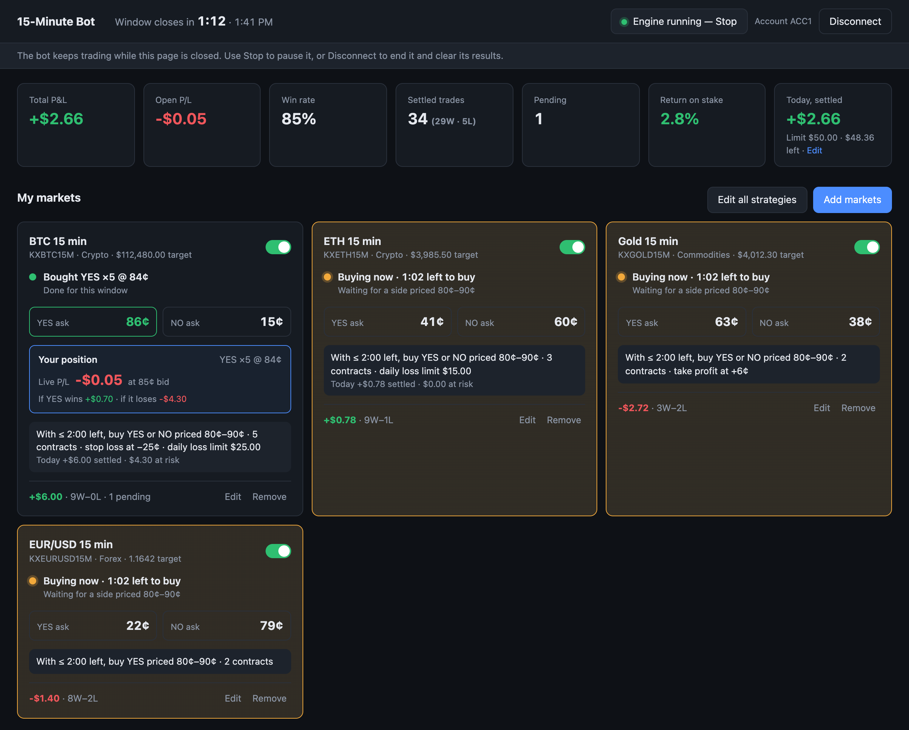

# 15-Minute Prediction Market Trading Bot - Public.com

An open-source Python trading bot for automating 15-minute prediction markets on Public.com,
including event contracts tied to Bitcoin (BTC), Ethereum (ETH), gold, and foreign exchange
(forex).

The bot uses the Public API and Python SDK to monitor available markets, evaluate contract prices,
and place orders based on user-defined trading rules. It runs locally on your computer and
includes a browser-based dashboard for managing strategies, monitoring positions, and tracking
trading activity.



*The dashboard, shown with sample data.*

## Key features

- **Automated 15-minute trading:** Monitor recurring prediction markets and place orders based on
  predefined conditions.
- **Multi-asset support:** Access supported Bitcoin, Ethereum, cryptocurrency, commodity, and
  forex event contracts.
- **Custom trading strategies:** Configure contract price ranges, trading windows, position sizes,
  and eligible outcomes.
- **Automated order execution:** Submit supported limit orders through Public’s API.
- **Take-profit and stop-loss rules:** Configure optional early-exit conditions, subject to
  liquidity and execution availability.
- **Daily loss limits:** Set optional limits for the whole account and for each market. The bot
  skips any buy that could take the day’s losses past a limit.
- **Trading dashboard:** Monitor active markets, positions, profit and loss, win rates, and
  transaction history.
- **Local execution:** Run the bot on your computer with your own Public API credentials.

> **Important:** This bot can place real trades using real money. Trading begins only after you
> explicitly start it. Event contracts involve significant risk, including the potential loss of
> the entire purchase amount plus applicable fees. Automated trading does not eliminate market or
> execution risk.

Explore [15-minute prediction markets on Public](https://public.com/prediction-markets/15-min) or
read the [15-minute prediction market API and Python SDK guide](https://github.com/PublicDotCom/publicdotcom-py).

## Getting started

### 1. What you need

- **A computer that stays on and awake while the bot trades.** The bot runs inside the app on
  your computer: it keeps trading with the browser closed, but stops if the app stops or the
  computer sleeps. It's built and tested on macOS.
- **A Public.com brokerage account** that can trade prediction markets. If you can buy a 15-minute
  market (e.g. "BTC 15 min") in Public's own app, you're set.
- **git**, to download the code (macOS asks to install it the first time you run `git`).
- **uv**, the Python tool that installs and runs the app. You don't need to install Python yourself;
  uv downloads the right version the first time.

  ```sh
  brew install uv                                    # with Homebrew
  # or
  curl -LsSf https://astral.sh/uv/install.sh | sh    # without Homebrew
  ```

  Check it worked with `uv --version`.

### 2. Get the code and install

```sh
git clone https://github.com/PublicDotCom/15-minute-prediction-market-bot.git
cd 15-minute-prediction-market-bot
uv sync
```

The first `uv sync` takes a minute, because uv downloads Python 3.14 and the app's libraries into a
private `.venv` folder in the project. Nothing is installed system-wide.

### 3. Create a Public API key

1. Log in to public.com and open the API settings page: <https://public.com/settings/security/api>.
   The setup wizard also links to it.
2. Generate a secret key and copy it.

Treat the key like a password: anyone who has it can trade in your account. If it's ever exposed,
delete it on that same page and it stops working immediately.

### 4. Start the app

```sh
uv run python -m fifteen_bot
```

Your browser opens at <http://127.0.0.1:8765>. Leave the terminal window open: closing it stops
the app, and with it the bot.

To keep your Mac awake while the bot runs, start it like this instead:

```sh
caffeinate -i uv run python -m fifteen_bot
```

`caffeinate -i` stops the Mac idle-sleeping, but closing a laptop lid still puts it to sleep.

### 5. Follow the setup wizard

1. **Connect**: paste your API key.
2. **Account**: pick the brokerage account the bot should trade in.
3. **Markets**: choose which 15-minute markets to trade. Start with one or two.
4. **Your rule**: set when and what to buy, and optionally when to sell early (take-profit and
   stop-loss) and a daily loss limit for each market. A live example shows what a trade would
   cost and pay.
5. **Review**: check what each trade can cost, optionally set a daily loss limit for the whole
   account, then **Start trading**, or **Finish without starting** and press Start on the
   dashboard later.

### 6. Day to day

- **Start/stop trading:** the **Engine** button in the top bar. **Stop** pauses new orders and
  keeps your markets, rules and results. Contracts you already hold settle as normal.
- **Close the browser whenever you like:** the bot keeps trading as long as the app is running.
  Open <http://127.0.0.1:8765> again in the same browser and you're straight back on the
  dashboard, with live P/L and the full history since you started. In another browser, paste
  your key again to rejoin the same bot.
- **Change a market's rule:** **Edit** on its card, or **Edit all strategies** for every market.
- **Turn a market on/off:** the switch on its card.
- **Daily loss limits (optional):** one for the whole account (**Edit** on the "Today" tile) and
  one per market (in its rule). See "Daily loss limits" below for how they work.
- **See results:** the dashboard shows total P&L, win rate, a per-market table, every trade and an
  activity log. A trade shows as won/lost a few minutes after its window closes, once Public
  settles it.
- **Disconnect** (top bar) ends your session: the bot stops, unfilled orders are cancelled, and
  your markets, rules and results are cleared.
- **Stop the app:** press **Ctrl+C** in its terminal. By default that ends the session just like
  Disconnect, so next time you set the bot up again. To have it carry on where it left off
  instead, turn on saving (below).

## Keeping your bot through restarts (optional)

By default nothing is written to disk: your key, markets, rules and results live only in the
app's memory. To keep them when you stop and start the app, give it a database file and an
encryption key:

```sh
# Once: create an encryption key, and keep a copy somewhere safe (e.g. a password manager).
uv run python -c "from cryptography.fernet import Fernet; print(Fernet.generate_key().decode())"

# Every time you start the app:
DATABASE_URL=sqlite:///bot.db SESSION_ENCRYPTION_KEY=<your key> uv run python -m fifteen_bot
```

- **What's saved:** your session in `bot.db` in the project folder: markets, rules, trade history,
  the account you picked, whether the bot was running, and your API key **encrypted** with the
  encryption key. Without the encryption key, the file is useless to anyone who copies it.
- **When you start the app again,** your bot resumes exactly where it was, **still trading if it
  was running when you stopped**. Orders that were open when you stopped are picked up again.
  While the app was stopped, the bot couldn't trade, so windows in that gap are missed.
- **Disconnect** deletes everything saved for your session. So does leaving the bot stopped
  with no page open for a day.
- **One copy at a time:** if you start a second copy of the app on the same database file, it
  waits (the page shows "The bot is restarting") until the first one stops, so two copies can
  never trade the same account.
- **Keep the same encryption key.** If you start the app with a different one, saved sessions
  can't be read: they're deleted and you set the bot up again. To change keys without losing
  anything, start once with `SESSION_ENCRYPTION_KEY=<new key>,<old key>` (the app re-encrypts
  everything with the new key), then use just `<new key>` from then on.
- `DATABASE_URL` also accepts a Postgres database (`postgresql://…`).

## Updating the app

Stop the app (Ctrl+C), then:

```sh
git pull                       # get the latest code
uv sync                        # only needed if dependencies changed; safe to run anyway
uv run python -m fifteen_bot   # with the same DATABASE_URL and SESSION_ENCRYPTION_KEY, if you use them
```

Always restart after an update. The browser loads the new page right away, but the running app
keeps the old code until it restarts, and the mix causes odd errors. With saving turned on, your
bot carries on after the update; without it, you set it up again.

## Your API key and privacy

- The key is used only to talk to Public. It's never written to logs or shown on the page again,
  and it's only written to disk if you turn on saving, and then only encrypted.
- The app listens only on your own computer (`127.0.0.1`), so other devices on your network can't
  reach it, and it refuses requests from other websites (strict Content-Security-Policy, no
  cookies, no framing).
- Your browser remembers your session (a random token in `localStorage`, never the key), which is
  what lets you come back without pasting the key. Anyone using your browser on this computer
  could control the bot until you click **Disconnect**. Deleting the key in Public's API
  settings also cuts it off immediately.
- If Public stops accepting the key for two minutes (e.g. you deleted it), the app ends the
  session by itself.

## Configuration

| Setting | Default | What it does |
|---|---|---|
| `--port` (or `PORT`) | `8765` | Port the dashboard is served on |
| `--no-browser` | off | Don't open the browser on start |
| `DATABASE_URL` | unset | Turns on saving: `sqlite:///bot.db`, or `postgresql://…` (see above) |
| `SESSION_ENCRYPTION_KEY` | unset | Encrypts your saved API key; required with `DATABASE_URL`. Comma-separate two to change keys (new one first) |

Advanced, for when several people share one running copy or it runs behind a proxy: `--host`
(default `127.0.0.1`, this computer only), `MAX_SESSIONS` (default `200`, the most people
connected at once) and `FORWARDED_ALLOW_IPS` (default `127.0.0.1`, proxies whose `X-Forwarded-*`
headers are trusted). Each person connects with their own key and gets their own bot.

## Troubleshooting

| Problem | Fix |
|---|---|
| Odd errors after an update | The app is still running old code. Restart it (Ctrl+C, then start again). |
| "Public didn't accept that key" | Copy the whole key again, or generate a new one. Check it wasn't deleted in Public's API settings. |
| "Couldn't reach Public" | Check your internet connection and try again. |
| "Your session has ended" | You clicked Disconnect, the app was stopped (without saving turned on), the bot sat stopped with no page open for a day, or Public stopped accepting the key. Connect again. |
| "The bot is restarting" for more than a few seconds | Another copy of the app is running on the same database file. Stop it (Ctrl+C in its terminal). |
| "Reconnecting to the bot…" banner | The page lost its connection to the app and is retrying. If the app is still running, the bot keeps trading meanwhile. |
| Port 8765 is already in use | Another copy is probably still running. Stop it, or start this one with `--port 9000`. |
| The browser doesn't open | Go to <http://127.0.0.1:8765> yourself, or start with `--no-browser` and open it when you like. |
| A card says "Not supported" | Markets with more than two outcomes (e.g. "Crypto Leader") can't be traded yet. Remove it. |
| A card says "Waiting for fresh prices" | Normal for a moment after starting or a network blip. If it persists, check your connection. |
| Use a different API key | Disconnect, then connect with the new key. |
| Start completely fresh | Disconnect. With saving turned on you can also stop the app and delete `bot.db`. |

## How Automated 15-Minute Prediction Market Trading Works

- A "market" is a recurring series such as `KXBTC15M`. Every 15 minutes it opens a new window
  (event). Each market has its own rule and can be switched on/off independently.
- Rule: between *start* and *stop* seconds before the window closes, buy YES/NO/either side
  once its ask is within *[lowest, highest]* chance (price in ¢ = implied %). At most **one trade
  per market per window**. Defaults: 2:00 → 0:10 left, 80–90%, either side, 1 contract.
- Orders are DAY limit buys at the ask rounded up to the cent, so you never pay more than the
  price the rule matched. Unfilled orders are cancelled when the window closes.
- **Selling early (optional):** a rule can also set a *take-profit* and/or a *stop-loss*, in ¢ per
  contract after fees. While the window is open and the engine is running, once
  `bid − estimated selling fee − (entry price + buying fee per contract)` is at least the
  take-profit, or at most minus the stop-loss, the bot sells the filled contracts with a DAY
  limit sell at the bid (rounded down to the cent). A sell that hasn't filled after 5 seconds is
  cancelled and re-placed at the new bid while the target still holds. A buy still filling is
  cancelled first. If Public rejects a sell, the bot doesn't retry, and the position settles as
  normal. Open sells are cancelled when the window closes.
- **Fees on a sell** are estimated as the same per-contract fee Public quoted for the buy, since
  Public gives no fee estimate for a sell before it's placed. The P&L of sold contracts uses that
  estimate too.
- After a window settles the trade is marked won/lost and P&L is recorded
  (`$1 × contracts still held` if won, plus anything sold early, minus cost and Public's estimated
  fees). A position sold out completely is marked **sold** straight away, and counts as a win or a
  loss by its P&L.
- **Selling early has been used in live trading:** stop-loss sells have filled through Public's
  API. The SDK only has a helper for buying event contracts, so sells are sent as generic `SELL`
  limit orders on the `EVENTCONTRACT` instrument. A sell still isn't guaranteed to fill, so try a
  take-profit or stop-loss on a 1-contract position before relying on it.
- With saving turned on, **every order is saved before it's sent**, so even after a crash the app
  knows about every order that could exist at Public and never places one twice. If the database
  can't be written, the bot doesn't send the order.

### Daily loss limits

Both are optional: one for the whole account, and one per market (part of the market's rule).

- **A limit is never passed.** Before each buy the bot works out the worst case for the day:
  today's settled P&L (gains give room), plus everything its open trades could still lose (as if
  every one lost; an order still filling counts in full), plus this buy and its fees. If that
  could pass the market's limit, or the account's limit across every market, the buy isn't
  placed. Buys that happen at the same moment in several markets can't pass a limit together.
- **Once a buy is skipped, buying stays stopped:** for that market, until you press **Resume** on
  its card (or switch it off and on); for the account limit, on every market, until you press
  **Resume** in the top bar (or Stop and Start). It doesn't restart by itself, even on a new day.
  Resuming with the same limit on the same day usually stops again at the next buy, so raise the
  limit first to trade more that day.
- **Selling carries on while buying is stopped:** take-profit and stop-loss sells, and settlement,
  continue as normal.
- **A day starts at midnight US Eastern**, so only trades that settled since then count as today's.
- Only the bot's own trades count, from this session: not other trades in your Public account,
  and not trades from before a Disconnect.

### Staying under Public's rate limit

Public allows 10 API requests per second per account. Every request the bot makes goes through a
limiter (`fifteen_bot/ratelimit.py`) that sends at most 8 per second, evenly spaced, with orders
and cancels ahead of routine price checks. If Public still answers 429, requests pause for its
Retry-After time. To keep traffic low, prices for all markets come from one batched quote request
and open orders from one order search; typical use is 1–3 requests per second. Requests time out
after 10 seconds, so one slow response can't make the bot miss a buy window. Other tools calling
Public's API for the same account at the same time count toward the same limit.

## Frequently asked questions

### What is a 15-minute prediction market trading bot?

A 15-minute prediction market trading bot is software that monitors short-duration event contracts
and executes supported trades based on predefined rules. Public’s open-source Python bot supports
automated workflows for eligible 15-minute prediction markets using the Public API.

### Can you automate 15-minute Bitcoin prediction markets?

Yes. Public’s 15-minute trading bot supports automated trading workflows for Bitcoin (BTC) event
contracts. Users can configure conditions such as contract prices, time remaining, and position
sizes. Orders are subject to market availability, liquidity, and execution limitations.

### Where can I find an open-source 15-minute prediction market bot?

The Public 15-Minute Bot is an open-source Python project for automating supported prediction
market trading through Public’s API. It includes configurable strategies, order execution, and a
browser-based dashboard.

### Does the bot support Ethereum, gold, and forex prediction markets?

Yes. The bot supports available 15-minute event contract series across multiple asset classes,
including Bitcoin, Ethereum, gold, and selected forex pairs. Specific market availability depends
on the contracts supported through Public’s API.

### Does the bot use Public’s API and Python SDK?

Yes. The bot uses the official [Public Python SDK](https://github.com/PublicDotCom/publicdotcom-py)
to communicate with Public’s API, retrieve supported market information, and submit orders.
Developers can also follow the
[15-minute prediction market API guide](https://github.com/PublicDotCom/publicdotcom-py) to build
their own programmatic workflows.

### Can I configure take-profit and stop-loss rules?

Yes. The bot includes optional take-profit and stop-loss settings for attempting to close
positions before expiration, and early sells have filled in live trading through Public’s API.
However, orders may fail to execute, and configured thresholds do not guarantee a particular exit
price or limit losses. To cap how much the bot can lose in a day, set a daily loss limit.

### Does the bot run 24/7?

The bot can monitor supported 15-minute prediction markets continuously while the application is
running and the computer remains awake. It stops operating if the application closes or the
computer sleeps. Market availability and trading interruptions may affect execution.

### Is automated prediction market trading profitable?

Profitability is not guaranteed. Automated trading strategies remain exposed to market
fluctuations, trading fees, liquidity constraints, and execution risk. The bot’s historical
win-rate and profit-and-loss reporting do not predict future performance.

## For developers

```sh
uv run pytest                                          # run the tests
TEST_DATABASE_URL=postgresql://… uv run pytest         # also test against a real Postgres
uv run python -m fifteen_bot --port 9000 --no-browser  # other port, no auto-open
```

```
fifteen_bot/
  app.py        web server: JSON API + WebSocket + dashboard, all scoped per session
  sessions.py   sessions: create/rejoin by key, idle expiry, resume/suspend (tested)
  persist.py    optional saving: encryption, SQLite/Postgres, one-copy-at-a-time lock (tested)
  engine.py     the trading loop: windows, quotes, orders, early exits, settlement
  ratelimit.py  keeps a session under Public's 10/s limit (tested)
  strategy.py   strategy model and pure decision logic (tested)
  store.py      in-memory SQLite for one session's markets, rules and trades
  static/       dashboard (plain HTML/CSS/JS, no build step)
.github/        CI: the tests, on every pull request
docs/           the dashboard screenshot in this README
tests/          uv run pytest
```

`GET /healthz` reports whether the app is up and `"ready"` (has loaded any saved sessions).

Uses the official [`publicdotcom-py`](https://github.com/PublicDotCom/publicdotcom-py) SDK.
